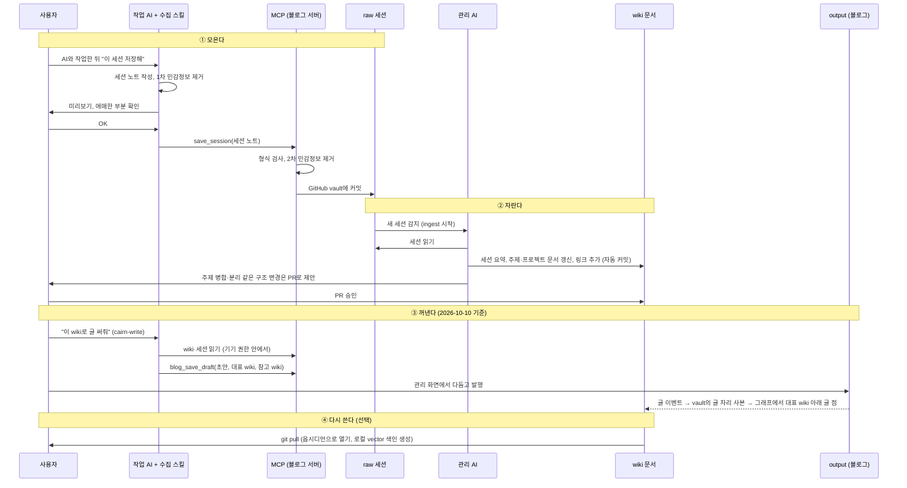

# 기획서 (가칭)

> MVP 범위·화면·스택·일정은 [MVP-기획서.md](MVP-기획서.md)를 본다. 이 문서는 전체 결정 기록이다.

> 상태: 초안 · 최종 수정 2026-09-27
> 이름과 라이선스는 미정

## 목차

1. [개요](#1-개요)
2. 핵심 개념 — 작성 예정
3. [동작 방식](#3-동작-방식)
4. [기능 정리 (CRUD)](#4-기능-정리-crud)
5. 시스템 구조 — 작성 예정
6. 어댑터 규격 — 작성 예정
7. [데이터 형식 명세 (초안)](#7-데이터-형식-명세-초안)
8. 공개 범위와 보안 — 작성 예정
9. AI 권한 정책 — 작성 예정
10. 설치와 배포 — 작성 예정
11. MVP 범위와 로드맵 — 작성 예정
12. [결정 기록](#12-결정-기록)
13. [미결정 사항](#13-미결정-사항)

---

## 1. 개요

### 1.1 한 줄 정의

**AI 작업 세션을 모아 지식 그래프로 자라게 하고, 그중 원하는 것을 블로그 글로 꺼내 쓰는, 직접 설치하는 오픈소스 블로그 엔진.**

### 1.2 배경

AI 에이전트(Claude Code, Codex 등)로 작업하는 개발자는 매일 많은 세션을 만든다. 이 세션에는 문제를 푼 과정, 설계 판단, 시행착오가 그대로 담겨 있지만 현실은 이렇다.

- 세션이 **컴퓨터마다 흩어져** 있다. 집에서 한 작업을 회사 컴퓨터에서 찾을 수 없다.
- 세션 파일은 **쌓이기만 하고 정리되지 않는다.** 프로젝트를 넘나드는 주제는 연결되지 않는다.
- 좋은 작업 과정이 있어도 **글로 옮기려면** 다시 처음부터 정리해야 한다.

### 1.3 대상 사용자

- AI 에이전트로 일상적으로 작업하는 개발자
- 여러 컴퓨터를 오가며 작업하는 사람
- 자기 작업 과정을 기록하고 공개하고 싶지만, 글쓰기 부담 때문에 못 하는 사람
- 데이터를 자기 저장소와 자기 서버에 두고 싶은 사람 (self-hosted 선호)

### 1.4 핵심 기능: 다섯 개의 기둥

| 기둥 | 설명 |
|---|---|
| **모은다** | 여러 컴퓨터의 AI 세션을 MCP로 내 Cairn 서버(Postgres) 한곳에 모은다. |
| **자란다** | 내 AI 도구가 MCP로 정리 일거리를 빌려 가 세션을 wiki로 정리하고, 카테고리와 연결을 만든다(서버에는 AI가 없다). 모든 변경은 변경 묶음으로 남고 서버의 검토 규칙을 거친다. 결과는 **그래프**로 보인다. |
| **꺼낸다** | wiki와 세션을 재료로 내 AI 도구가 블로그 초안을 쓰고(`cairn-write`), 내가 다듬어 발행한다. 글은 대표 wiki 하나와 참고 wiki를 가리켜 그래프에 함께 보이지만, 비공개 wiki·세션의 이름과 내용은 드러나지 않는다. |
| **다시 쓴다** | 보관 형식(md·yml·사진)으로 내보내거나 GitHub 동기화 플러그인으로 저장소에 받아, 옵시디언이나 로컬 AI에서 쓴다. |
| **지킨다** | 위 전체에 걸친 전제. 세션과 wiki는 기본 비공개이고, 올리기 전에 민감정보를 제거하며, 공개 여부는 서버에서 거른 뒤에 개수·순위를 계산한다. |

```
 [여러 컴퓨터의 AI 도구]
     │  세션 올리기 (MCP)
     │  정리 일거리 빌려 가기 · 결과 내기
     │  초안 쓰기 (cairn-write)
     ▼
 [내 Cairn 서버 · Postgres]
     ├──▶ 그래프 (방문자: 모양 전체 + 공개만 내용)
     ├──▶ 블로그 (글 → 대표 wiki · 참고 wiki)
     └──▶ 내보내기 · GitHub 동기화 (md·yml·사진) → 옵시디언 · 로컬 AI
```

### 1.5 비슷한 서비스와의 차이

| 서비스 | 하는 것 | 이 프로젝트와의 차이 |
|---|---|---|
| WordPress.com + MCP, Elementor Angie | AI 에이전트가 블로그 글·사이트를 편집 | 입력이 "내가 쓰라고 시킨 글"이다. 이 프로젝트는 **AI 작업 세션 자체가 원재료**다. |
| Notion, Beehiiv 등 AI 블로깅 | AI 글쓰기 보조 | 글쓰기 보조는 목표가 아니다. |
| Obsidian | 로컬 마크다운 지식 그래프 | 세션 수집, 관리 AI, 공개 블로그가 없다. 이 프로젝트의 vault는 **옵시디언과 호환**된다. |
| LLM Wiki (Karpathy 패턴, nashsu/llm_wiki 앱) | 원천 자료(raw)를 LLM이 위키(wiki)로 정리. 옵시디언 호환 vault, 그래프, 클러스터 탐지, 선택형 vector, Ollama 지원, MCP | **정리하는 방식(가운데 층)을 공유하는 선행 사례.** 차이는 앞과 뒤다. 원재료가 직접 넣는 문서가 아니라 **여러 컴퓨터에서 자동으로 모이는 AI 작업 세션**이고, 결과가 나만 보는 지식이 아니라 **공개 그래프와 블로그 글**이다. 데스크톱 앱이 아니라 git 기반의 self-hosted 서버다. |

한 줄로 요약하면: **"AI 작업 세션을 위한 LLM Wiki, 그리고 그걸 공개하는 블로그."**

### 1.6 설계 원칙

1. **원본은 Postgres, md는 내보내기 형식이다.** 검색 조각과 vector는 언제든 다시 만들 수 있는 파생물이다 (2026-10-03 결정으로 바뀜).
2. **데이터는 사용자 소유다.** 보관 형식(md·yml·사진)으로 언제든 전부 내보내고 다시 복원할 수 있고, 내보낸 vault는 옵시디언에서 그대로 열린다.
3. **AI는 가져와서 쓴다(BYO AI).** 엔진은 AI에게 시킬 일만 정의하고, 어떤 AI가 할지는 사용자가 고른다.
4. **최소 요구사항은 "서버 하나 + AI 하나"다.** vector 검색, 실시간 동기화 같은 것은 켜면 좋아지는 옵션이다.
5. **모든 변경은 변경 묶음으로 남는다.** AI가 한 정리도 git의 커밋처럼 기록되고, 서버의 검토 규칙을 거치며, 되돌릴 수 있다.

---

## 3. 동작 방식

> **주의 (2026-10-03)**: 원본 저장소가 git에서 서버 DB로 바뀌고 블로그가 세션을 참조하지 않기로 하면서, 이 장의 git 커밋·`outputs/`·근거 연결 관련 흐름은 낡았다. 최신 흐름은 4장을 따른다.

LLM Wiki 패턴의 "원천 자료 → 위키 → 산출물" 흐름을 따른다. 차이는 원천 자료가 **AI 작업 세션**이고, 자동으로 모이며, 산출물이 **공개 블로그 글**이라는 점이다.

### 3.1 세 개의 층

| 층 | 위치 | 누가 쓰나 | 성격 |
|---|---|---|---|
| **raw 세션** | `raw/sources/sessions/` | 수집 스킬이 작성 → MCP가 커밋 (추가만, 수정 안 함) | 근거. 작업한 AI가 직접 쓴 세션 노트와 원문 인용 |
| **wiki 문서** | `wiki/` | 관리 AI | 해석과 정리. 세션 요약, 주제, 프로젝트 문서, 링크 |
| **블로그 글** (vault 밖, 별도 저장소) | `cairn-blog/posts/` | 사용자가 작성, 관리 AI는 초안만 | vault를 재료로 새로 만든 독립 데이터. 세션을 참조하지 않음 (2026-10-03 결정) |

### 3.2 수집: 스킬이 정리하고, MCP가 커밋한다

사용자는 작업하는 AI 도구에 **블로그의 MCP를 등록**하고 **수집 스킬을 설치**한다. 스킬은 공개 표준(SKILL.md)이라 Claude Code, Codex CLI, Gemini CLI 등에서 같은 스킬을 쓴다.

| 역할 | 어디서 | 하는 일 | 하지 않는 일 |
|---|---|---|---|
| **수집 스킬** | 사용자의 AI 도구 안 | 세션을 읽고 세션 노트 작성 (제목, 한 일, 결정, 막힌 점, 핵심 원문 인용, 프로젝트, 태그). 1차 민감정보 제거. 사용자에게 미리보기 | git, GitHub 인증 |
| **MCP** | 블로그 서버 | 노트 수신, 형식 검사, 2차 민감정보 제거, 등록된 GitHub vault에 커밋 | 내용 해석, 분류 (AI 없이 동작) |
| **관리 AI** | 블로그 서버 | 커밋된 세션을 읽고 wiki 정리 (3.3) | raw 세션 수정 |

- 사용자 컴퓨터에는 **git도, GitHub 인증도 필요 없다.** GitHub 인증은 서버에만 있다.
- 세션 노트를 쓰는 건 **그 작업을 방금 한 AI**다. 로그를 사후에 해석하는 것보다 정확하다.
- MCP는 AI 없이 검사하고 커밋만 한다. 그래서 싸고 예측 가능하다. 해석은 관리 AI가 따로 한다.
- 스킬을 쓸 수 없는 환경(일부 웹 채팅 등)에서는 MCP 도구 설명만 보고도 노트를 보낼 수 있게 한다.

### 3.3 전체 흐름



**주기 작업 (lint)**: 관리 AI가 정기적으로 wiki를 점검한다. 끊어진 링크, 고립된 문서, 중복 주제, 오래된 내용을 찾아 고치고, 결과는 `wiki/log.md`에 남긴다.

### 3.4 원칙

1. **raw 세션과 wiki 문서를 섞지 않는다.** raw 세션은 근거이고, wiki 문서는 해석이다. 섞으면 어떤 내용이 실제 작업 기록이고 어떤 내용이 AI의 재구성인지 알 수 없다. raw 세션은 작업 당사자(작업한 AI)의 기록이고, wiki는 제3자(관리 AI)의 정리다.
2. **관리 AI는 raw 세션을 고치지 않는다.** 세션은 추가만 된다. 삭제는 사용자만 할 수 있다.
3. **wiki 문서는 근거가 된 세션을 가리킨다.** frontmatter의 `sources`로 추적한다. **블로그 글은 세션을 가리키지 않는다** (2026-10-03 결정, 11장 참고).
4. **블로그 글은 사람이 발행한다.** AI는 초안까지만 만든다.
5. **모든 변경은 커밋으로 남긴다.** AI 작업 내역은 `wiki/log.md`에도 한 줄씩 추가한다.

---

## 4. 기능 정리 (CRUD)

> 2026-10-03 기준. 원본 저장소는 서버 DB(Postgres)이고, 세션 vault와 블로그는 서로 참조하지 않는다는 전제로 정리했다.

### 4.1 등장인물

| 누구 | 어디서 | 권한 |
|---|---|---|
| **작업하는 나** | 각 컴퓨터의 AI 도구 (Claude Code, Codex 등) + 수집 스킬 | MCP로 세션 올리기·읽기 |
| **관리자인 나** | 블로그 서버의 관리 모드 (웹) | 모든 데이터 수정·삭제·승인 |
| **관리 AI** | 블로그 서버 안 | 정리·연결 자동 반영, 사람이 손댄 것은 제안만 |
| **방문자** | 블로그 서버의 공개 화면 | 공개 그래프와 발행된 글 읽기만 |

### 4.2 데이터

| 영역 | 데이터 | 설명 |
|---|---|---|
| 세션 vault | **세션** | 세션 노트(md). 원본은 고정, 수정은 판(revision)으로 쌓임 |
| | **첨부** | 이미지·문서 파일. 내용 해시로 저장, 기본 비공개 |
| | **주제** | 관리 AI나 내가 만든 묶음 |
| | **연결선** | 세션↔주제, 세션↔세션 (소속·관련·비슷함) |
| | **제안** | 관리 AI의 구조 변경 제안, 원본 충돌 |
| | **기기** | MCP에 연결된 컴퓨터와 토큰 |
| 블로그 | **글** | 본문 md, 상태(임시·발행), 카테고리 |
| | **카테고리** | 내가 만든 글 분류 트리 |
| | **블로그 사진** | 글에 쓰는 사진 (세션 첨부에서 가져오면 복사본) |

두 영역 사이에는 참조가 없다. 블로그를 쓸 때 vault를 **읽어서 복사**할 뿐이다.

### 4.3 CRUD 표

| 데이터 | 만들기 (C) | 읽기 (R) | 고치기 (U) | 지우기 (D) |
|---|---|---|---|---|
| 세션 | MCP `save_session` | 관리 모드, MCP `search`·`get`, 방문자(공개만, 제목·내용) | MCP 재전송 = 새 원본 판 (자동 합치기, 겹치면 충돌 제안). 관리 모드 직접 수정 = 사람 판 | 관리 모드만. 휴지통 30일 후 영구 삭제 |
| 첨부 | MCP `attach_file` 또는 업로드 주소 | 관리 모드, MCP | 바꾸지 않음 (새 파일로 교체) | 관리 모드만 |
| 주제 | 관리 AI 자동 / 관리 모드 | 그래프, MCP | 이름·색·합치기·나누기 (사람이 정하면 AI는 제안만) | 관리 모드 (소속 세션은 다른 주제로 이동하거나 미분류) |
| 연결선 | 관리 AI 자동 / 관리 모드에서 끌어서 연결 | 그래프, MCP `neighbors` | 종류 변경 | 관리 모드 (지운 기록이 남아 AI가 다시 만들지 않음) |
| 제안 | 관리 AI, 원본 충돌 시 서버 | 관리 모드 승인함 | 승인·보류·직접 고쳐서 승인 | 처리하면 닫힘 |
| 기기 | 관리 모드에서 토큰 발급 | 관리 모드 | 이름·권한(쓰기/읽기) | 연결 끊기 (토큰 폐기) |
| 글 | 관리 모드 블로그: 빈 글 / 세션 골라 AI 초안 | 방문자(발행된 것), 관리 모드(전부) | 블록 편집기·md, 저장마다 판 | 휴지통 → 영구 삭제 |
| 카테고리 | 관리 모드 블로그 | 방문자, 관리 모드 | 이름·순서·하위 카테고리, 글 끌어 옮기기 | 비어 있을 때만, 아니면 글을 옮긴 뒤 |
| 블로그 사진 | 업로드 / 세션 첨부에서 복사 | 방문자 | 교체 | 쓰는 글이 없을 때 |

### 4.4 네 가지 흐름

**① 올리기 (C·U)**
작업하는 나 → 스킬이 세션 노트 정리 → MCP `save_session` (+ `attach_file`) → 서버가 형식 검사·2차 민감정보 제거 → 세션 원본 판 저장 → 관리 AI가 요약·주제·연결 정리. 같은 세션을 이어서 올리면 새 원본 판이 되고, 내가 고친 부분과 겹치면 승인함에 충돌로 올라간다.

**② 정리하기 (U·D)**
관리자인 나 → 관리 모드. 잘못 올린 세션 지우기, 노트 고치기, 공개 범위 바꾸기, 그래프에서 연결선 만들고 지우기, 주제 합치고 나누기, 관리 AI 제안 승인, 충돌 해결. 모든 변경은 기록되고 되돌릴 수 있다.

**③ 다른 컴퓨터에서 쓰기 (R)**
작업하는 나 → 다른 컴퓨터의 AI 도구 → MCP 읽기 도구(`search_sessions`, `get_session`, `neighbors`, `list_topics`) → 과거 세션과 그래프를 작업에 참고. 이 경로는 읽기 전용이고, 지우기는 관리 모드에서만 한다.

**④ 글쓰기 (블로그 C·U·D)**
관리자인 나 → 관리 모드의 블로그. 빈 글로 시작하거나, 세션을 골라 관리 AI에게 초안을 받는다. 편집 화면 옆 재료 패널에서 vault를 검색해 내용·사진을 복사해 넣는다. 복사한 순간 글의 일부가 되고 출처는 남지 않는다. 임시 저장 → 발행 → 수정 → 휴지통.

### 4.5 공통 규칙
- **지우기는 관리 모드에서만.** MCP는 올리기와 읽기만 한다. 실수로 지워지는 경로를 줄인다.
- **지운 것은 휴지통에 30일.** 영구 삭제는 휴지통에서 따로 한다.
- **모든 수정은 판으로 쌓인다.** 세션과 글 모두 이전 판으로 돌아갈 수 있다.
- **사람이 정한 것이 우선.** 관리 AI는 사람이 손댄 세션·주제·연결선을 자동으로 바꾸지 못하고 제안만 한다.
- **MCP 토큰은 기기별, 권한별.** 쓰기(올리기)와 읽기를 따로 줄 수 있다.
- **방문자는 공개된 것만.** 비공개 세션은 그래프에 빈 점으로만, 첨부는 기본 비공개.


### 4.6 스킬 (내 컴퓨터의 AI 도구에 설치)

| 스킬 | 부르는 말 (예) | 하는 일 | 쓰는 MCP 도구 | 필요한 권한 |
|---|---|---|---|---|
| **cairn-save** (넣기) | "이 세션 저장해", `/cairn-save` | 세션 노트 작성 → 1차 민감정보 제거 → 미리보기 → 올리기, 첨부 올리기 | `save_session`, `attach_file`, `upload_url` | 올리기 |
| **cairn-tidy** (정리) | "cairn 정리해", `/cairn-tidy` | 서버 일거리를 가져와 처리: 새 세션 요약·주제 배정·연결, 충돌 합친 문장 추천, 점검(끊긴 연결·고립 세션·중복 주제), 요청된 블로그 초안. 끝나면 결과 보고 | `next_jobs`(임대), `search_sessions`, `get_session`, `list_topics`, `neighbors`, `submit_result`, `release_job` | 읽기 + 정리 |
| **cairn-recall** (읽기) | "지난번에 이거 어떻게 풀었지?", `/cairn-recall` | 작업 중 막히거나 비슷한 일을 할 때 과거 세션과 주제를 찾아 요약해 참고. 찾은 세션 제목과 날짜를 함께 보여줌 | `search_sessions`, `get_session`, `neighbors`, `list_topics` | 읽기 |
| **cairn-write** (글쓰기) | "글감으로 블로그 초안 써줘", "방금 한 거 글로 써줘", `/cairn-write` | 글감 상자(세션·사진·참고 링크·참고 글·메모)와 지금 대화를 재료로 개요 → 초안 작성. 사진은 블로그 쪽으로 복사해 배치, 외부 자료는 링크로 출처 표기. 블로그 문체 가이드를 따름. 초안 저장까지만 | `basket_get`, `basket_add`, `search_sessions`, `get_session`, `blog_search`, `blog_get_post`, `blog_upload_asset`, `blog_copy_asset`, `blog_save_draft`, `blog_style` | 읽기 + 글쓰기 |

- 두 스킬은 따로 부른다. 넣기가 끝나면 "이어서 정리할까요?"만 묻는다.
- 정리는 **미리보기 모드**(무엇을 바꿀지 보여주고 끝냄)와 **빠른 모드**(새 세션만)를 지원한다.
- 주기 점검은 같은 정리 스킬을 예약 실행으로 부른다 (예: `claude -p "/cairn-tidy"`).
- 사람 우선 규칙, 구조 변경의 승인함 전환, 결과 형식 검사는 **서버가 강제**한다. 스킬은 서버를 믿고 제안할 뿐이다.
- 스킬은 연결 명령(`cairn connect`)에 함께 들어 있고, 명령을 다시 부르면 새 버전으로 바뀐다. 블로그가 스킬을 내려주지 않는다 (스킬의 스크립트·허락 목록을 연결한 블로그가 바꿀 수 없게). 도구의 입력 모양은 AI가 MCP 서버에서 직접 받는다.


### 4.7 동시성과 트랜잭션 (초안)

**원칙**
1. **들어온 정보는 버리지 않는다.** 세션 올리기는 항상 새 판을 *추가*(INSERT)할 뿐, 기존 행을 덮어쓰지 않는다. 동시에 들어와도 서로 부딪히지 않는다.
2. **같은 요청은 한 번만 반영한다.** 스킬이 요청마다 고유 ID(`request_id`)를 보내고, DB 유일 제약으로 재전송 중복을 막는다.
3. **"지금 보여줄 판"만 낙관적 잠금으로 바꾼다.** `version`이 맞을 때만 갱신하고, 어긋나면 합치기 일거리를 만든다.
4. **AI가 생각하는 동안 트랜잭션을 열어 두지 않는다.** 일거리를 짧게 빌리고(임대), 밖에서 처리한 뒤, 짧은 트랜잭션으로 결과를 제출한다.
5. **제출 시점에 다시 검사한다.** 빌릴 때의 버전과 지금이 다르거나 사람이 손댄 대상이면, 적용하지 않고 제안으로 바꾼다.

**트랜잭션 경계**

| 동작 | 한 트랜잭션 안에서 하는 일 |
|---|---|
| T1 세션 올리기 | 판 INSERT(`request_id` 유일) → 세션 행 없으면 생성 → 현재 판 포인터를 버전 비교로 갱신, 실패 시 합치기 일거리 → 새 세션 정리 일거리 → outbox |
| T2 첨부 올리기 | (트랜잭션 밖에서 파일을 해시 이름으로 저장) → 첨부 행 INSERT, 판과 연결 |
| T3 일거리 빌리기 | `SELECT … FOR UPDATE SKIP LOCKED LIMIT n` → 상태 `leased`, 만료 시각, 빌린 기기 기록 |
| T4 정리 결과 제출 | 변경 묶음 열기 → 대상 행 잠금 → 버전 검사 → 변경마다 검토 규칙 판정: 바로 합칠 것은 적용, 검토는 승인함으로, 거부는 이유와 함께 → 일거리 완료 → 변경 기록 → outbox |
| T5 관리 모드 수정 | 버전 비교 → 사람 판 INSERT 또는 그래프 변경 → 사람 표시 → 변경 기록 |
| T6 검토 승인 | 묶음·대상 잠금 → 그사이 바뀌었는지 재검사(바뀌었으면 밀려남) → 적용 → 기록 |
| T7 되돌리기 | 되돌리는 새 변경 묶음으로 이전 상태를 적용 (기록은 지우지 않음) |

**변경 묶음과 검토 규칙** (2026-10-10): 모든 그래프 변경(AI 정리, 대정리, 관리 화면 편집, 되돌리기)은 git의 커밋처럼 변경 묶음 하나로 남는다. AI의 묶음은 서버가 변경마다 검토 규칙(바로 합치기 / 검토 / 거부)을 대 본다. 기본 규칙: AI가 새로 더하는 것과 AI가 만든 것을 고치는 것은 바로, 사람이 정한 것·구조·공개·삭제를 바꾸는 것과 큰 묶음(대상 50개 이상)은 검토. 주인은 관리 화면에서 규칙마다 값을 바꾼다. 아래에서 "제안"은 검토를 기다리는 변경을 말한다.

**동시성 허용 범위**

기준: *데이터를 잃지 않는 곳까지는 막지 않고, 사람의 의도끼리 부딪히는 곳에서는 멈추고 사람에게 묻는다.*

| 단계 | 대상 | 처리 |
|---|---|---|
| 1. 그냥 동시에 | MCP 읽기 전부, 서로 다른 세션 올리기, 첨부 올리기, 서로 다른 일거리 정리, 서로 다른 글 편집 | 조정 없음 |
| 2. 둘 다 받고 나중에 합침 | 같은 세션을 두 곳에서 올림, 올리기 vs 관리 모드 수정 | 두 판 모두 저장, 합치기 일거리 (겹치면 승인함 충돌) |
| 3. 먼저 온 것 적용, 나중 것은 제안 | 정리 결과 vs 사람 수정, 같은 대상의 정리 결과 두 개 | 제출 시 재검사, 늦은 쪽은 제안으로 |
| 4. 하나씩 차례로 | 같은 주제의 합치기·나누기·삭제, 같은 제안의 승인, md 내보내기, DB 마이그레이션 | 범위 단위 잠금 |
| 5. 막고 사람에게 물음 | 관리 화면 두 곳에서 같은 세션 노트나 같은 글을 고침 | 나중 저장을 거절하고 차이 비교 화면 |

**내가 편집하는 중에 같은 세션의 새 원본이 들어올 때**
- 새 원본은 **막지 않고 바로 저장**한다. 다만 "지금 보여줄 판"으로 올리지 않고 **보류**한다.
- 편집을 시작하면 그 세션에 **"사람이 편집 중" 표시**(하트비트로 유지, 2분 끊기면 자동 해제)를 건다. 그동안 그 세션의 정리 일거리와 AI의 연결 변경은 **미뤄 둔다**.
  - 구현: 세션 행을 고치지 않고 별도 `edit_leases` 테이블(세션 ID, 잡은 화면, 만료 시각)에 행을 넣는다. DB 잠금을 편집 내내 잡고 있지 않는다. AI는 DB에 직접 닿지 않고 서버의 MCP 도구로만 움직이므로, 서버가 ① 일거리를 빌려줄 때 편집 중인 세션을 빼고 ② 결과를 받을 때 다시 확인해서 편집 중이면 적용하지 않고 미룬다. 편집 시작과 결과 제출이 동시에 일어나면 두 트랜잭션이 세션 행을 수 밀리초 잠가 순서를 정한다.
- 편집 화면에 실시간 알림을 띄운다: "새 원본이 방금 들어왔어요 (macbook-home)" → [차이 보기] [계속 편집].
- 저장하면 편집을 시작한 판을 기준으로 칸 단위 3-way 합치기를 한다. 겹치지 않으면 자동 합침, 겹치면 **승인함이 아니라 편집 화면 안에서 바로** 고르게 한다.
- 아직 들어오는 중인 세션(최근 몇 분 안에 판이 계속 들어옴)은 편집을 시작할 때 "끝난 뒤 고치는 걸 추천해요"라고 알린다.
- 그래프 편집(주제 소속, 연결선)은 노트 본문과 다른 데이터라 서로 충돌하지 않는다. 새 원본 때문에 AI가 연결을 바꾸려 하면, 사람이 정한 연결은 유지하고 제안으로만 올린다.

**지원하지 않음**: 여러 사람의 공동 관리(주인은 한 명), 구글 문서 같은 실시간 공동 편집, 관리 화면의 오프라인 편집, 세션 사이의 전역 순서 보장(같은 세션 안의 판 순서만 서버 수신 순으로 보장).

**MCP 요청은 큐에 넣지 않고 바로 처리한다.** 각 요청은 수 밀리초짜리 트랜잭션 하나로 끝나고, 결과(저장됨/중복/경고)를 즉시 돌려준다. 큐는 요청 *뒤*에만 둔다: 후속 작업(2차 민감정보 검사, 이미지 처리, 색인, 임베딩, md 내보내기)은 outbox → Postgres 기반 작업 큐(`SKIP LOCKED` + `LISTEN/NOTIFY`)로 처리하고, Redis 같은 별도 큐 서버는 두지 않는다.

주제 합치기처럼 여러 행을 건드리는 작업은 주제 단위 advisory lock으로 직렬화한다. 검색 색인, 임베딩, md 내보내기, 관리 화면 실시간 갱신은 outbox를 읽어 비동기로 처리한다.


### 4.8 알림 (초안)

**무엇을 알리나**

| 등급 | 이벤트 | 기본 방식 |
|---|---|---|
| **즉시** | 새 기기 연결, 처음 보는 곳에서의 접근, 민감정보 의심, 원본 충돌, 백업 실패 | 바로 알림 |
| **묶음** | 세션 들어옴, 정리 완료 결과, 승인할 제안, 정리 대기 쌓임(노트북이 꺼져 있음), 스킬 업데이트 필요 | 모아서 (예: 1시간 또는 하루 한 번) |
| **기록만** | 자동 반영된 정리, 읽기 기록 | 알림 센터에만 |

**어디로 보내나**

| 경로 | 설명 |
|---|---|
| 관리 모드 알림 센터 | 종 모양 아이콘 + 실시간 갱신 (outbox → SSE). 항상 켜짐 |
| AI 도구 안 | 스킬이 MCP를 부를 때 응답에 "승인 대기 3건" 같은 알림을 실어 보냄. 작업 중에 자연스럽게 확인 |
| 브라우저 푸시 | Web Push. 외부 서비스 없이 서버 키로 보냄. 휴대폰은 홈 화면에 추가하면 받음 |
| 메신저 웹훅 | Slack, Discord, Telegram 등 웹훅 주소만 넣으면 됨 |
| 이메일 | SMTP 설정 시. 하루 요약 위주 |

알림은 `notifications` 테이블에 쌓고(종류, 등급, 제목, 링크, 읽음 시각, 보낸 경로), 알림 일꾼이 outbox를 읽어 만든다. 같은 종류는 묶어서 보내고, 조용한 시간과 종류별 경로를 설정에서 고른다.

---

## 7. 데이터 형식 명세 (초안)

> 2026-10-03 초안. Postgres 하나에 `vault`(세션·그래프)와 `blog` 두 스키마. 두 스키마 사이에는 외래키가 없다.

### 7.1 문서를 저장하는 방식: 세 겹

| 겹 | 형태 | 역할 |
|---|---|---|
| **원문** | `TEXT` (md 그대로) | 진실의 원본. 내보내기하면 그대로 .md 파일이 된다 |
| **쪼갠 칸** | `JSONB` (세션 노트의 칸별 내용 + 칸별 해시) | 칸 단위 3-way 합치기, 화면 표시, 칸별 차이 비교 |
| **찾기용 복사본** | 세션 행의 `head_*` 열 + 검색 색인, 선택적으로 임베딩 | 목록·검색·그래프를 빠르게. 현재 판이 바뀔 때 같은 트랜잭션에서 갱신 |

판(revision)은 **추가만** 하고 고치지 않는다. 지금 보여줄 판은 부모 행의 포인터와 `version`으로 가리킨다.

### 7.2 vault 스키마

```sql
-- 기기와 인증
devices(id, name, scopes text[], last_seen_at, revoked_at)
device_tokens(id, device_id, token_hash, expires_at)          -- OAuth 실패 시 예비 토큰

-- 그래프의 점: 세션과 주제를 한 표로 묶어 연결선이 하나의 외래키로 걸리게 함
nodes(id uuid PK, kind text CHECK (kind IN ('session','topic')),
      created_at, deleted_at)

sessions(
  node_id uuid PK REFERENCES nodes,
  device_id, tool text, source_session_id text,               -- 스킬이 보낸 원래 세션 ID
  project text, visibility text DEFAULT 'private',
  head_revision_id uuid, version int DEFAULT 1,               -- 지금 보여줄 판 + 낙관적 잠금
  head_title text, head_summary text, head_text text,         -- 찾기용 복사본
  pinned_fields text[] DEFAULT '{}',                          -- 사람이 고친 칸 (AI 자동 변경 금지)
  started_at, last_revision_at,
  UNIQUE (device_id, tool, source_session_id))

session_revisions(
  id uuid PK, session_id uuid REFERENCES sessions,
  kind text CHECK (kind IN ('origin','human','merge')),
  parent_ids uuid[],                                          -- 합친 판은 부모 둘
  body_md text NOT NULL,                                      -- 원문
  sections jsonb NOT NULL,                                    -- {"title":…,"did":…,"decisions":…,"blocked":…,"quotes":[…],"_hash":{…}}
  content_hash text, request_id text UNIQUE,                  -- 같은 요청 중복 방지
  created_by text,                                            -- device:<id> | owner | ai:<device>
  created_at)

attachments(hash text PK, mime, size, width, height, storage_key, created_at)
revision_attachments(revision_id, hash, visibility DEFAULT 'private', PRIMARY KEY (revision_id, hash))

topics(node_id uuid PK REFERENCES nodes, name, color,
       origin text CHECK (origin IN ('ai','human')), pinned bool, version int)

edges(
  id uuid PK, src uuid REFERENCES nodes, dst uuid REFERENCES nodes,
  kind text CHECK (kind IN ('belongs','related','similar')),
  weight real, origin text, pinned bool,
  deleted_at timestamptz,                                     -- 지운 기록을 남겨 AI가 다시 만들지 않게
  version int, UNIQUE (src, dst, kind))

node_layout(node_id PK, x real, y real, pinned bool)          -- 그래프에서 내가 고정한 위치 (선택)

-- 운영
jobs(id, kind, target_node uuid, base_version int, status, lease_until, leased_by, attempts, payload jsonb)
change_sets(id, kind, status, actor, message, created_at)       -- 변경 묶음 (git의 커밋). 자세한 건 테이블 설계 3장
change_ops(change_set_id, seq, op, target, base_version, verdict, rule, status)   -- 검토를 기다리는 것 = 승인함
edit_leases(target uuid PK, holder text, base_revision uuid, expires_at)
changes(id bigserial, actor, entity, entity_id, op, before jsonb, after jsonb, created_at)   -- 되돌리기용
outbox(id bigserial, topic, payload jsonb, created_at, processed_at)

-- 선택 기능
session_embeddings(session_id, revision_id, chunk_no, model, embedding vector(1024))
```

색인: `sessions(head_text)`에 pg_bigm GIN(한국어 검색), `edges(src)`, `edges(dst)`, `jobs(status, lease_until)`, `session_revisions(session_id, created_at)`.

### 7.3 blog 스키마 (vault와 외래키 없음)

```sql
posts(id uuid PK, slug text UNIQUE, title, status text CHECK (status IN ('draft','published')),
      category_id, head_revision_id, version int, cover_asset text,
      published_at, deleted_at)
post_revisions(id, post_id, body_md text, blocks jsonb, created_by, created_at)   -- blocks: 렌더링용으로 파싱한 결과
categories(id, parent_id, name, sort int, version int)
assets(hash text PK, mime, size, width, height, storage_key)                      -- 세션 첨부에서 가져오면 새로 복사
post_assets(post_id, hash)
```

### 7.4 왜 문서 DB가 아니라 Postgres인가
- 판 추가·포인터 갱신·일거리 임대·사람 우선 검사를 **한 트랜잭션**에 묶어야 한다.
- 연결선의 유일 제약, 지운 기록, 외래키 같은 **관계 규칙**이 많다.
- 문서다운 유연함은 `TEXT`(원문)와 `JSONB`(칸, 메타데이터)로 충분히 얻는다.


### 7.5 md 파일 형식 (내보내기·가져오기용)

원본은 DB이고, md는 내보내기와 옵시디언 호환을 위한 교환 형식이다. 확장은 세 군데에서만 한다.

| 확장 위치 | 담는 것 | 방식 |
|---|---|---|
| **frontmatter** (맨 위 YAML) | 식별자, 판 정보, 메타데이터, 소속 주제와 관련 세션 | 옵시디언 속성과 호환되는 **평평한 키**. Cairn 전용 키는 `cairn_` 접두어 |
| **본문 소제목** | 세션 노트의 칸 | `## 한 일`, `## 결정`, `## 막힌 점`, `## 인용`, `## 기타` 고정 → DB의 `sections`로 변환 |
| **본문 문법** | 사진, 링크, (블로그의) 가운데 정렬·갤러리·영상 | 표준 md + `[[위키링크]]` + `:::`/`::` 확장 문법 (블로그만) |

**세션 예시** (`sessions/api-server/2026-09-27-oauth-refresh.md`)
```md
---
cairn_format: 1
cairn_type: session
cairn_id: s_8f2a91
cairn_rev: 3
cairn_base: r_77e0c4
title: OAuth 토큰 갱신이 두 번 일어나는 버그
visibility: public
project: api-server
device: macbook-home
tool: claude-code
started: 2026-09-27T09:40
updated: 2026-09-27T11:02
topics:
  - "[[인증과 토큰]]"
related:
  - "[[2026-09-27-token-expiry-test|토큰 만료 처리 테스트 정리]]"
tags: [버그, 동시성]
---

## 한 일
동시 요청 두 개가 만료된 토큰을 동시에 갱신하던 문제를 …

## 결정
진행 중인 갱신을 기다리게 한다.

## 막힌 점
테스트의 시간 모킹이 잠금과 충돌했다.

## 인용
> 갱신 중이면 새로 요청하지 말고 그 결과를 기다리자


```

**주제 예시** (`topics/인증과-토큰.md`): `cairn_type: topic`, `cairn_id`, `title`, `color`, `origin: human|ai`. 소속 세션 목록은 적지 않는다 (옵시디언이 세션 쪽 링크로 백링크를 계산함).

**블로그 글 예시**: `cairn_type: post`, `cairn_id`, `cairn_rev`, `title`, `slug`, `status`, `category`, `published`, `cover`, `align`. 세션을 가리키는 키는 없다.

**md에 담는 것과 DB에만 두는 것**

| md에 담음 | DB에만 둠 |
|---|---|
| 식별자, 판 번호와 기준 판, 제목, 공개 여부, 출처(기기·도구·프로젝트), 시각, 태그 | 연결선의 가중치·출처(AI/사람)·고정 여부·지운 기록 |
| 소속 주제와 관련 세션 (`[[링크]]`로, 옵시디언 그래프에 그대로 보임) | 일거리, 제안, 편집 임대, 변경 기록, 임베딩 |
| 칸별 본문, 첨부 링크 | 칸별 해시 (가져올 때 다시 계산) |

**가져오기 규칙**: `cairn_id`로 대상을 찾고 `cairn_base`를 기준 판으로 삼아 칸 단위 3-way 합치기를 한다 (사람 판으로 기록). 모르는 frontmatter 키는 버리지 않고 `extra`(JSONB)에 보관했다가 다시 내보낼 때 그대로 돌려준다. `cairn_format`으로 형식 버전을 관리한다.

---

## 12. 결정 기록

| 날짜 | 결정 | 이유 |
|---|---|---|
| 2026-10-24 | **블로그 글 쓰기·고치기·지우기와 글마다 공개 범위 (M4 일부를 앞당김).** 공개 범위는 임시(나만) · 공개(목록에 보임) · 링크만(목록·검색·RSS에는 안 나오고 주소로만, noindex) 셋 (`posts.status`에 `unlisted`). 저장할 때 제목·본문이 바뀌었으면 새 판, 판에 제목도 남긴다 (`post_revisions.title`). 주소는 제목에서 (한글 그대로, 겹치면 -2), 직접 정한 주소가 겹치면 거절. 휴지통은 30일 보관(영구 삭제 일꾼은 뒤 단계). 공개 범위·휴지통·공개된 글 고치기는 주인만 (AI 도구의 글쓰기 권한은 임시 글까지). 본문은 md + 도구 막대 + 미리 보기, 글 전체 가운데 정렬 스위치와 `::: center` · `> [!quote]`. md 표시는 unified/remark(`remark-directive`로 정해 둔 블록 문법을 그대로 읽음, 본문 HTML은 그리지 않고 `rehype-sanitize`로 한 번 더 거름). 방문자 화면은 밝은 읽기 화면(`/posts`, `/posts/<주소>`), 편집기는 `/admin/posts/<id>` | 관리자가 블로그 글을 바로 쓰고 공개 범위를 정할 수 있어야 테스트 서버를 블로그로 쓸 수 있다. 링크만 공개는 초안을 몇 사람에게만 보여줄 때 필요. markdown-it은 `::youtube{}` 같은 지시문을 직접 만들어야 해서, 의존 패키지가 많아도 정해 둔 문법을 그대로 읽는 remark를 골랐다 |
| 2026-10-19 | **`cairn-save` 2판과 네 도구 지원.** ① 세션 노트는 **raw**(그 일을 한 AI가 남기는 근거)다. 해석·일반화는 wiki(관리 AI)의 일이라 노트에 쓰지 않는다. 노트 규칙(`references/note-rules.md`): 일어난 일만, 항목마다 근거 번호(U 사용자 말 · R 명령 결과 · A AI의 말 · F 바뀐 파일 · C 커밋)를 근거표에, 인용은 원문 글자 그대로, 사용자가 정하지 않은 것은 결정이 아니라 "제안" ② **여러 번 검토**: 기계 검사(MCP `check_session` + `scripts/check.mjs`가 인용을 원문과 대조) → 사실 검토(초안 + 근거 묶음) → 경계 검토(초안 + 규칙) → 다시 검토 최대 2번 → 사용자 확인. 검토자는 이 대화를 모르는 다른 맥락: 하위 에이전트 → 다른 AI 명령줄(`--review-with`, 다른 회사 모델로 교차 검토) → 직접("독립 검토 아님"을 미리보기에). "빠르게"면 경계 검토 한 번만 ③ MCP: 읽기 도구 `check_session`(올리기 전 검사·request_id·대화 id·같은 대화의 앞선 판), 도구 성격 표시(annotations), 서버 안내문(instructions)에 저장 순서 ④ 도구: Claude Code · Codex는 `cairn connect [--tool codex]`가 스킬·검토자를 넣는다. **Claude 앱 · ChatGPT도 MVP에 넣는다**: 주인이 기기 시트에서 "ChatGPT·Claude 앱 연결 허용"을 켜면(기본 꺼짐, `account.settings`의 `connect.hosted_apps`) 돌려보낼 주소로 claude.ai · chatgpt.com의 정해진 콜백 주소만 더 받는다 (2026-10-19 D의 "localhost만"을 넓힘). 승인 화면은 앱의 연결이면 "직접 누른 연결일 때만 승인"을 알리고, 승인 응답에 `iss`(RFC 9207). 앱에는 블로그가 주는 스킬 zip(`/api/skills/cairn-save.zip`, 주인만, SKILL.md와 규칙만, 스크립트 없음)을 사용자가 직접 올린다. zip은 `platform/base`의 `ZipFile`(node:zlib, 라이브러리 없음) | 같은 맥락에서 혼자 다시 보면 같은 실수를 못 본다. 검토자에게 작성자의 생각 없이 초안과 근거만 주면 지어낸 내용·고쳐 쓴 인용이 드러난다. raw가 틀리면 wiki가 그 위에 쌓인다. 앱은 회사 서버에서 들어오므로 공개 https가 있어야 하고, 남이 만든 앱 연결 링크를 주인이 누르는 경우를 스위치(기본 꺼짐)와 승인 화면 경고로 막는다. 앱용 zip은 주인이 자기 블로그에서 받아 직접 올리고 스크립트가 없어, "연결한 블로그가 이 컴퓨터에서 코드를 돌리는" 길(D에서 막은 것)이 생기지 않는다 |
| 2026-10-19 | **기기 연결 명령과 `cairn-save` 스킬 (M1 D).** 스킬은 `skills/cairn-save`(SKILL.md + 값을 만드는 `scripts/context.mjs`): 준비(새 request_id·프로젝트·올릴 곳) → 노트 쓰기(대화 전체를 다시 정리) → 1차 민감정보 지우기 → 미리보기(**올릴 블로그 주소를 보여줌**) → `save_session` → 결과 알리기. `cairn connect <주소>`(packages/cli, 배포 전에는 `pnpm cairn connect`)는 블로그 확인(RFC 9728 안내 문서의 사이트 주소) → `claude` 찾기 → 스킬 넣기(`~/.claude/skills`, 표시 파일 `.cairn.json`) → `claude mcp add --scope user cairn` → `claude mcp login cairn`(블로그 승인 화면) → 연결 확인. 로그인과 토큰 보관·갱신은 Claude Code가 한다. **스킬은 명령에 함께 든 것만 넣고 블로그에서 받지 않는다. 자동 올리기는 없다.** **돌려보낼 주소(redirect_uri)는 이 컴퓨터(localhost)만** (2026-10-10의 "https 또는 localhost"를 바꿈). OAuth 안내 문서에 `offline_access`. MCP 이름은 `cairn` 하나라 한 컴퓨터는 블로그 하나에 연결. npm 패키지 이름은 M5에서 | 남이 보낸 승인 링크를 눌러도 열쇠가 내 컴퓨터로만 가서 가져갈 수 없다. 블로그가 내려주는 스킬은 실행 스크립트와 "묻지 않고 허락" 목록 때문에 그 블로그가 이 컴퓨터에서 코드를 돌릴 수 있게 된다. 세션 종료 훅은 AI에게 노트를 쓰게 할 수 없다. CLI가 직접 로그인해 토큰을 설정 파일에 적으면 원문이 남고 갱신을 못 한다 |
| 2026-10-18 | **보안 정리.** ① 서버 응답은 모두 `Cache-Control: no-store`·`nosniff`, 서버 종류를 알리지 않고, JSON 본문은 512KB까지 ② 웹 화면은 `frame-ancestors 'none'`·`form-action 'self'`·Referrer-Policy·HSTS 등 머리글 (스크립트 출처까지 막는 전체 CSP는 M4에서 플러그인 스크립트와 함께) ③ 로그인 쿠키로 오는 쓰기 요청은 `Sec-Fetch-Site`가 cross-site가 아니고 `Origin`이 사이트 주소(정하기 전이면 요청이 온 주소)일 때만, 아니면 403 `origin`. Bearer(AI 도구)·읽기는 보지 않는다 ④ URL·쿠키에 싣는 짧은 값(승인 요청·설치 통행증·로그인 확인값)은 서명 대신 암호화(`SecretBox.pack`, 만료 시각도 안에) ⑤ 사이트 주소는 https만, 이 컴퓨터 안의 주소(localhost 등)만 http (집 안 서버도 Caddy·Tailscale로 https) ⑥ `/oauth/register`는 IP당 1시간 20번, 하루 동안 토큰을 받지 않은 등록은 지움 ⑦ README에 배포 규칙(프록시만 열기, X-Forwarded-Proto·For). 새 라이브러리·마이그레이션 없음 | 비밀번호·쿠키·토큰이 http로 오가거나, 다른 사이트가 주인의 로그인으로 쓰기 요청을 보내거나, URL에 실린 값이 풀려 보이는 길을 막는다. 머리글 몇 줄이라 helmet을 넣지 않고, SameSite 쿠키에 출처 확인 두 겹이면 CSRF 토큰 없이 충분. 앱 단 페이로드 암호화는 열쇠를 숨길 곳이 없어 하지 않는다 |
| 2026-10-10 | **세션 저장(M1 C) 세부.** 같은 대화(공간·기기·도구·대화 id)의 저장은 그 대화 자리를 잠가 하나씩 처리한다(세션이 아직 없어도). 같은 request_id는 `Idempotency`(platform/base, 호출한 쪽의 트랜잭션)가 처음 결과를 돌려준다. 이미 있는 어느 판과 내용이 같아도 `unchanged`이고 지금 판은 그대로다. 서버의 2차 민감정보 제거는 확실한 모양(개인 키, GitHub·AWS·Slack·AI API·Cairn 토큰, JWT, 숫자가 섞였거나 16자 이상인 `password=` 값)만 지우고 `[지움: 종류]`를 남긴다. 프로젝트 규칙(`project_rules`)은 관리 화면이 생길 때 읽고, 그전에는 새 세션이 늘 비공개다. 도구 응답의 링크에 쓸 사이트 주소는 MCP 입구(mcp 모듈)가 읽어 도구에 넘긴다 | 50번 동시 저장에서 다시 시도 없이 판 50개(유실 0). 판은 고칠 수 없어 놓친 비밀값은 영구 삭제로만 지울 수 있고, 너무 넓게 지우면 코드 인용이 망가진다. vault는 account를 모르므로 사이트 주소를 직접 읽지 않는다 |
| 2026-10-10 | **기기 연결(MCP OAuth 2.1)은 OAuth 경로를 직접 만들고, MCP SDK는 MCP 통신(Streamable HTTP·도구 호출)에만 쓴다** (M1 결정의 "SDK OAuth 도우미"를 바꿈). 안내 문서(RFC 8414·9728), 동적 등록(RFC 7591, 공개 클라이언트, https 또는 localhost 주소만), 승인(PKCE S256만), 토큰(access 1시간·refresh 30일, 쓸 때마다 새로), 무효(RFC 7009). 승인을 기다리는 요청은 DB에 두지 않고 서버 키로 서명해 승인 화면 주소에 싣는다(10분). 기기는 코드를 토큰으로 바꿀 때 만든다(그만둔 승인은 남지 않음). 이미 쓴 갱신 토큰이 다시 오면 도난으로 보고 기기를 끊는다. 예비 기기 토큰(cairn_dt_)은 관리 화면에서 한 번만 보여준다. SDK는 1.30.1로 고정 | SDK의 OAuth 라우터는 인가 서버 주소를 시작할 때 고정하는데, Cairn의 사이트 주소는 주인이 나중에 정한다. 경로가 표준이고 작아서 객체 설계(Entity·Service)대로 만드는 편이 고치기 쉬움. 공식 SDK 클라이언트로 붙어 보아 규격을 확인함 |
| 2026-10-10 | **주인 로그인은 아이디·비밀번호로 (B). GitHub 로그인은 플러그인으로** (2026-10-03 결정을 바꿈). 비밀번호는 Node 내장 scrypt로 바꾼 값만 저장(강도를 적어 두고 약하면 다음 로그인 때 다시 저장), 10자 이상·조합 규칙 없음, 아이디는 영문 소문자·숫자·-·_ 3~40자. 틀린 시도만 세어 한 곳 1분 10번·한 아이디 1분 5번까지, 아이디가 없어도 같은 문구·같은 시간. 잊으면 서버에서 `pnpm owner reset-password`(모든 로그인 끝). 설치 마법사는 설치 코드 → 주인 계정 → 블로그 정보 → 플러그인 → 첫 기기의 5단계. 외부 로그인(GitHub 등)은 확장 지점 `login:<이름>` 플러그인이 더하고, 주인에게 연결된 계정(`login_links`)으로만 로그인된다 | 외부 서비스 연동은 플러그인이라는 원칙. 설치할 때 GitHub 앱을 만들어야 하는 번거로움과 외부 의존을 없앰. 서버에 접속할 수 있는 사람이 주인이라 비밀번호 되찾기는 명령줄로 충분 |
| 2026-10-10 | **M1(수집) 방식.** 순서는 설치·주인 로그인 → 기기 연결(MCP OAuth) → 세션 저장 → 스킬·연결 명령 → 보관 형식(세션), 첨부는 그다음 따로. 외부 주소는 하나: `/api`·`/mcp`·`/oauth`·`/.well-known`은 서버, 나머지는 웹. MCP SDK를 넣되 `platform/base` 안에서만 감싸 쓴다. YAML은 `yaml` 패키지(보관 형식 때), zip과 GitHub 로그인은 라이브러리 없이. 설치 코드는 서버 키에서 만들고 저장하지 않는다. 오류 종류에 429(`TooManyRequests`). 세션 저장은 변경 묶음이 아니라 판으로만 남고, AI는 공개 여부를 정할 수 없다 | 조각마다 끝을 테스트로 확인하며 작게 만든다. 라이브러리는 규격이 크고 자주 바뀌는 MCP와 사람이 고친 파일을 읽어야 하는 YAML만 |
| 2026-10-10 | **남은 미결정 항목을 정한다.** 라이선스 AGPL-3.0 · 첫 지원 도구 Claude Code · 수집은 스킬을 부를 때만(자동은 기기별 선택) · 세션 노트 칸 확정, 인용 4,000자 넘으면 거절 · 새 기기 기본 권한 올리기 + 공개 읽기, 추가 승인 없이 즉시 알림 · 설치 마법사에 플러그인 단계 · 임베딩 384차원 · 비공개 점의 날짜 숨김 · 주소(slug) 한글 허용 · 공감(돌 얹기)은 코어에서 빼고 플러그인 후보 · 임대 15분 + 연장 · 주기 점검은 내가 부르는 스킬 · llm_wiki 형식 맞추지 않음 · 휴지통 30일 · 변경 전/후 값 1년, 묶음 기록은 계속 · 로그 월별 분할 안 함 · 자동 백업은 GitHub 동기화 플러그인 | 13장 목록과 MVP·테이블 설계의 정할 것을 정리. 세부는 각 문서의 목록에 |
| 2026-10-10 | **변경 묶음 세부.** 승인함은 `proposals` 대신 `change_ops` 중 검토를 기다리는 것(충돌·민감정보 경고도 시스템 묶음의 검토 항목). 관리 화면 편집도 변경 묶음(kind = human)으로 남겨 기록·되돌리기를 하나로. wiki의 칸은 md 제목(`##`) 단위. 테이블은 지금, 코드는 처음 쓰는 단계(M2 그래프 편집)에서 | 승인함·대정리·되돌리기·기록을 한 길로 만들어 두 번 구현하지 않음 |
| 2026-10-10 | **객체 규칙 예외: vault의 `ChangeService`만 여러 데이터 묶음(세션·wiki·카테고리·선)의 Repository를 한 트랜잭션에서 쓴다.** 그 밖의 Service는 그대로 데이터 묶음 하나만 | wiki 합치기처럼 세션 옮기기·선 정리·옛 주소 남기기가 한 번에 일어나야 하는 변경이 있음. 변경 묶음 적용을 한 곳으로 모아 규칙 판단도 한 곳에 둠 |
| 2026-10-10 | **AI 변경은 git처럼 "변경 묶음 + 서버의 검토 규칙"으로 다룬다.** AI가 결과를 한 번 낼 때마다 변경 묶음(커밋) 하나. 서버가 묶음 안의 변경마다 검토 규칙(GitHub 보호 브랜치·CODEOWNERS처럼 "무엇을 → 바로 합치기 / 검토 / 거부")을 대 보고, 검토는 승인함(PR), 되돌리기는 새 변경(revert), 대정리는 브랜치. 규칙은 관리 화면에서 고르는 설정이고 코드(함수)로 쓰게 하지 않는다. 숫자 한도는 따로 두지 않고 "묶음이 크면 검토" 규칙 한 줄로. 하네스(`CLAUDE.md`·MCP 안내)는 좋은 묶음을 만들게 돕는 안내일 뿐 벽이 아니다 | 사용자 쪽 규칙(git `pre-commit`, 하네스)은 건너뛸 수 있어 서버에 벽이 있어야 함(git 보호 브랜치, CouchDB `validate_doc_update`). CouchDB는 통과·거부만 있어 사람 검토가 필요한 Cairn에는 git의 PR 모델이 맞음. 평소 정리·대정리·되돌리기가 한 길을 씀 |
| 2026-10-10 | **wiki도 판을 쌓는다.** AI는 wiki를 계속 고칠 수 있고, 고칠 때마다 덮어쓰지 않고 새 판으로 저장한다. 사람이 직접 고친 칸은 AI가 바로 바꾸지 못하고 검토로 간다 (세션과 같은 규칙) | wiki는 AI와 사람이 함께 고치는 문서. 예전 판을 비교·되돌리기 할 수 있어야 하고, 세션과 같은 합치기 방식을 함께 씀 |
| 2026-10-10 | **그래프 보기 설정은 `vault.graph_views`에** (옛 `layouts`를 넓힘). 방문자 기본·주인 기본·저장한 보기를 행으로, 설정은 `settings`, 점 좌표는 `node_layout` | 같은 데이터를 여러 방식으로 보는 일을 테이블 하나로. 보기 설정이 늘어도 열을 늘리지 않음 |
| 2026-10-10 | **글 자리는 vault의 사본(`vault.post_marks`)으로.** blog가 글 이벤트를 보내고 vault의 Handler가 받아 적는다. 순서가 바뀌어도 글 version이 큰 것만 반영 | vault는 blog를 읽을 수 없음(모듈 규칙). 모듈을 서버로 나눠도 그대로 동작 |
| 2026-10-10 | **글이 참고한 세션 기록(`blog.post_sources`)을 뺀다.** 글의 출처는 참고 wiki(`post_wiki_refs`)로만 남기고, 세션은 wiki를 거쳐 안다 (2026-10-03 결정을 바꿈) | wiki가 세션을 모은 문서가 되면서 세션 복사본을 따로 둘 이유가 없어짐 |
| 2026-10-10 | **대정리는 "정리 계획"으로, MVP(M3)에 넣는다.** 바로 적용하지 않고 계획 → 전후 비교 → 골라 승인 → 일꾼이 나눠 적용 → 통째로 되돌리기. 공개 전환은 한 번 더 확인, 그동안 새 세션은 도착 구역에, wiki를 합치면 옛 id 연결표(`wiki_aliases`) | AI로 블로그 전체를 정리하는 일이 이 제품의 핵심 사용 장면. 미리 보고 고를 수 있어야 맡길 수 있음 |
| 2026-10-10 | **플러그인 켜기·설정은 `.env`가 아니라 DB에, 화면에서.** 설치 마법사의 플러그인 단계와 관리 화면(설정 → 플러그인)에서 켜고, 쓰는 권한을 확인하고, 설정 칸을 채운다 (화면 전에는 `pnpm plugin`). 비밀값은 서버 키(`CAIRN_SECRET_KEY`)로 암호화해 저장하고 화면에는 "설정됨"만. 재시작 없이 반영(이벤트 → 일꾼 다시 등록, 웹은 들어 있는 화면을 모두 넣고 켜진 것만 그림). `.env`에는 인프라만 | 플러그인은 블로그를 설치·운영하면서 켜고 바꿀 수 있어야 함. 서버 파일을 고치고 재시작하는 방식은 플러그인의 의미가 없음 |
| 2026-10-10 | **블로그 원본은 DB 그대로 두고, GitHub 동기화 플러그인으로 이력·백업을 한다 (B).** 블로그와 vault 전체(vault는 private 저장소일 때만), 사진 포함. **복원(가져오기)을 함께 만들고**, "내보내기 → 빈 DB에 가져오기 → 비교" 테스트를 CI에 둔다. 운영 데이터(일거리·제안·기기·토큰·알림)와 다시 계산되는 값(검색 조각·임베딩·스냅샷)은 내보내지 않는다. 똑같은 이사는 DB 백업, 사람이 읽는 이력·내용 복원은 GitHub 동기화로 나눈다. GitHub를 블로그 원본으로 두는 안(C)은 원칙 1·5·6과 발행 흐름을 바꿔야 해서 택하지 않음 | 목적은 이력·백업. 원본을 옮기면 동시성·비공개·트랜잭션 규칙을 다시 짜야 하지만, 동기화는 플러그인 하나로 같은 효과를 냄. 복원이 없는 내보내기는 막상 필요할 때 못 쓸 수 있음 |
| 2026-10-10 | **Cairn은 플러그인 구조로 간다. 댓글이 첫 플러그인이다.** 코어가 몰라도 되는 기능(댓글, 알림 채널, 내보내기 대상, 수집 어댑터 등)은 플러그인으로 만든다. 플러그인은 자기 스키마·마이그레이션을 갖는 작은 모듈이고, 정해진 확장 지점(이벤트 받기, MCP 도구, API 경로, 설정, 웹 화면 자리 등)에만 등록한다. 목록 파일(cairn-plugin.json)에 쓰는 확장 지점과 권한을 적고 관리자가 허락한 것만 켠다. 세부 인터페이스는 제안·승인 후 구현 | 오픈소스 엔진이라 사용자마다 필요한 기능이 다르고, 코어를 가볍게 유지해야 함. 댓글은 코어가 몰라도 되는 기능이라 플러그인 구조를 검증하기에 알맞음 |
| 2026-10-10 | **그래프 저장 방식: 대표는 열, 나머지는 선.** 세션 → wiki(`wiki_id`), wiki → 카테고리(`category_id`), 글 → wiki(`main_wiki_id`)를 열 하나로 두고, 비어 있으면 도착 구역·미분류·그래프에 안 나옴. 재료·wiki 링크·비슷함만 선. 주제(`topics`)는 카테고리(`categories`)로 바꾸고 순서·분류 기준을 둔다. 부모를 지워도 자식은 지워지지 않는다(`RESTRICT`·`SET NULL`) | 대표가 하나라는 규칙을 DB 구조로 지키고, 카테고리를 바꾸거나 합쳐도 바뀌는 행이 wiki 몇 개로 끝나게 하려고. 미분류를 행으로 두면 지우거나 이름을 바꿀 수 있어 예외가 생김 |
| 2026-10-08 | **그래프 화면은 옵시디언 그래프 뷰 방식으로 한다.** 점과 선이 힘으로 자리를 잡는 평면 그래프, 모든 연결은 흐린 선으로 보이고 고르면 이웃만 밝아진다. 돌멩이 캐릭터, 도시 지도, 3D 레이어 같은 게임·비유 요소는 두지 않는다. 같은 날 정한 데이터 형태(점 네 종류, 주소 하나 + 다른 연결)는 그대로 쓴다 | 지도·레이어·3D 시안 여러 개를 검토했지만 모두 보기 불편하거나 어색했음. 익숙하고 검증된 그래프 뷰로 돌아감 |
| 2026-10-08 | **그래프 형태를 "나무 + 선"으로 정한다.** 점은 카테고리(사용자가 만들고 AI는 제안) · wiki(AI가 여러 세션을 모아 쓴 정리 문서, 새 데이터) · 세션 · 블로그 글 네 종류이고 각자 주소가 하나(세션 → 대표 wiki, wiki → 카테고리, 글 → 대표 wiki). 세션은 여러 wiki의 재료가 될 수 있고, 주소 말고 다른 연결(재료·참고·wiki 링크)은 선으로 보인다. **블로그 글을 그래프에 두고 방문자에게도 보인다** (2026-10-03의 "그래프에 글 노드를 두지 않는다", "방문자에게 연결이 드러나지 않는다"를 대체). 비공개 wiki·세션은 자리만 보인다. 모양은 위에서 내려다본 밤의 도시 지도(카테고리 = 블록, wiki = 돌탑, 글 = 등불, 내 돌멩이 캐릭터) | 블로그가 세션과 함께 자라는 모습이 보여야 함. 실제 데이터는 얽혀 있어 나무만으로는 연결이 사라지고, 그물만으로는 보기 어려움. 주소 하나 + 선이면 지도는 깔끔하고 연결은 고를 때 보임 |
| 2026-10-08 | **모듈 = 스키마, 모듈 사이 외래키 없음.** `app` 스키마를 `account`·`platform`·`mcp`로 나누고 vault 소유 테이블(proposals·changes·edit_leases)은 `vault`로 옮김, 편집 임대는 vault·blog가 따로. 모듈 사이 외래키 30개 제거. 지금은 하나로 배포하는 모듈러 모놀리스로 두되, 경계 5개(테이블 주인 하나, `index.ts`로만, 후속 일은 이벤트, 요청자는 값, platform은 공통 기반만)를 지켜 나중에 모듈을 별도 서버로 뗄 수 있게 한다. 외부 라이브러리는 `platform/base`의 기반 클래스가 감싸고 모듈은 상속해서 쓴다. 새 라이브러리는 정해진 순서로 근거를 보이고 승인받는다. 규칙은 모듈별 `CLAUDE.md`와 `modules.json`, 검사는 `pnpm check`·`pnpm db:check` | 한 사람이 자기 서버에 설치하는 제품이라 지금 MSA는 설치·트랜잭션 비용만 큼. 데이터가 없는 지금 경계를 정리하는 게 가장 쌈. 라이브러리를 감싸 두면 바꾸거나 더할 때 고치는 곳이 기반 클래스로 좁혀짐 |
| 2026-10-08 | 서버 코드는 **[객체 설계 규칙](객체설계.md)**을 따른다: 4계층(진입·응용·도메인·저장), 객체 종류 고정(Controller/Tool · Response · Guard · Request · Service · Query · Entity · Policy · Actor · Repository · Gateway · Error), 데이터 묶음 단위 폴더, 쓰기는 엔티티를 거치고 읽기는 Query가 View로. 도메인 규칙은 `packages/core`가 아니라 각 모듈의 Entity·Policy에 두고 Nest에 의존하지 않게 한다 (2026-10-04 결정 일부 대체) | 어떤 객체가 어떤 행위를 맡는지 정해 두어야 코드가 한눈에 읽히고, 새 기능을 기계적으로 나눌 수 있음. 도메인을 모듈 안에 두면 한 데이터의 C·R·U·D가 한 폴더에 모임 |
| 2026-09-27 | 오픈소스 self-hosted 블로그 엔진으로 만든다 | 누구나 자기 서버에 설치해서 쓸 수 있게 |
| 2026-09-27 | AI 글쓰기 보조는 범위에서 제외한다 | 목표는 블로그가 세션과 함께 자라는 것 |
| 2026-09-27 | vault = 개인 GitHub private 저장소, 마크다운 원본 | 여러 컴퓨터 동기화, 이력, 옵시디언 호환을 git 하나로 해결 |
| 2026-09-27 | 그래프 노드 단위 = 세션 하나 | 그래프를 단순하게 유지. 검색 색인은 세션 내부 구간 단위로 쪼갤 수 있음 |
| 2026-09-27 | 관리 AI: 충돌이 없으면 자동 커밋, 구조 변경·병합은 PR 승인 | 가벼운 정리는 빠르게, 큰 변경은 사람이 확인 |
| 2026-09-27 | 관리 AI는 로컬 AI 또는 서버의 구독 AI CLI를 붙인다 | BYO AI. 사용자마다 쓰는 AI가 다름 |
| 2026-09-27 | vector 검색은 선택 기능 | 구독 AI CLI는 임베딩을 제공하지 않음. 기본은 AI가 쓴 링크 + 키워드 검색 |
| 2026-09-27 | 로컬 vector 색인은 각 컴퓨터에서 직접 만든다 | git에는 마크다운만. 컴퓨터마다 다른 임베딩 모델 허용 |
| 2026-09-27 | 그래프는 공개: 방문자는 전체 모양을 보고, 공개 노드만 열람 | 작업량과 흐름을 보여주면서 내용은 보호 |
| 2026-09-27 | 그래프와 블로그는 별개 기능. 블로그 글은 세션을 골라 만든다 | 그래프는 vault를 보는 화면, 블로그는 발행물 |
| 2026-09-27 | 서버리스가 아닌 상시 실행 서버가 필요 | AI CLI 실행, git clone, 로그인 유지가 필요 |
| 2026-09-27 | 동작 방식은 LLM Wiki 패턴(raw → wiki → output)을 따른다 | 검증된 방식을 재사용하고, 차별점(세션 자동 수집, 공개 발행)에 집중 |
| 2026-09-27 | 수집 = 스킬(세션 정리) + MCP(수신·커밋). 설치형 수집 프로그램은 만들지 않는다 | 스킬은 여러 AI 도구 공통 표준. 사용자 컴퓨터에 git·인증 불필요. GitHub 인증은 서버에만 |
| 2026-09-27 | raw 세션 = 작업한 AI가 스킬로 쓴 세션 노트 + 핵심 원문 인용 | MCP로는 긴 원본 로그를 보낼 수 없음. 원본은 사용자 컴퓨터를 떠나지 않음 |
| 2026-09-27 | MCP는 AI 없이 검사·커밋만 한다 | 해석은 관리 AI의 몫. 수신 경로를 싸고 예측 가능하게 유지 |
| 2026-09-27 | 프로젝트 이름은 Cairn | 세션 하나가 돌 하나, 쌓인 돌탑이 뒤에 오는 사람의 길이 된다. 같은 이름의 AI 노트·에이전트 프로젝트(ddutchie/cairn, iBlinkQ/project-cairn 등)가 있음을 알고 결정 |
| 2026-10-05 | 마이그레이션은 **SQL 파일 + dbmate**로 관리하고, Drizzle은 쿼리용으로만 쓴다(스키마는 DB에서 읽어 생성). 개발 환경은 Docker Compose 하나로 db → migrate → server → web 순서로 뜬다 | 부분 인덱스·HNSW 표현식 인덱스·트리거·DEFERRABLE 외래키를 그대로 표현하기 위해 |
| 2026-10-04 | 서버 프레임워크를 **NestJS**(Express 플랫폼)로 한다. api와 worker는 한 Nest 앱의 두 진입점, 도메인 규칙은 Nest에 의존하지 않는 `packages/core` | 모듈 구조가 강제되어 모듈별 규칙 문서와 잘 맞고, 기여자가 구조를 따라가기 쉬움. 내부가 Express라 MCP SDK 연결에 문제 없음 |
| 2026-10-03 | 글이 어떤 세션을 참고했는지 **참고 기록(`blog.post_sources`)**으로 남긴다. 글의 메타 정보로 세션 ID와 그때의 제목·출처를 복사해 저장, 외래키 없음, 관리 모드에서만 보임. 원칙을 "vault와 블로그는 **서로 의존하지 않고**(외래키·생명주기 공유 없음) **방문자에게 연결이 드러나지 않는다**"로 다듬음 | 글을 쓴 근거를 나중에 확인할 수 있어야 함. 세 가지 보호 목적(생명주기 독립, 비공개 보호, 그래프는 세션만)은 그대로 지켜짐 |
| 2026-10-03 | 그래프 검색은 **브라우저 먼저**. 이미 받은 그래프 안의 검색·거르기는 서버를 거치지 않고, 본문·의미 검색·아직 받지 않은 영역만 서버에 묻는다 | 이미 가진 데이터를 다시 서버에 물을 이유가 없음. 타이핑하는 대로 즉시 결과 |
| 2026-10-03 | 리버스 프록시·HTTPS는 Cairn에 넣지 않고 사용자가 준비한다 (Nginx Proxy Manager 등). Cairn은 필요한 프록시 설정을 문서로 제공 | 사용자가 이미 쓰는 웹 서버를 그대로 쓰도록 |
| 2026-10-03 | 그래프 데이터는 **미리 만든 스냅샷 + 변경분**으로 내려준다. 점·선 뼈대만 보내고 내용은 필요할 때, 좌표는 서버 일꾼이 계산, 공개 스냅샷은 모든 방문자에게 같은 파일을 캐시, 관리 모드는 SSE로 변경분. Redis 없이 파일·HTTP 캐시·IndexedDB로 해결 | 매 요청마다 DB에서 전체 그래프를 조립하면 그래프가 커질수록 느려짐 |
| 2026-10-03 | **의미 검색을 MVP에 넣는다.** 키워드(pg_bigm) + 의미(pgvector) 하이브리드, 임베딩은 서버 내장 소형 다국어 모델(CPU)로 계산해 서버 AI 없이도 동작. 이전의 "vector는 선택 기능" 결정을 대체 | 그래프가 커지면 정확한 단어를 모르는 상태로 찾아야 할 일이 많음. 임베딩 모델은 LLM이 아니라 로그인 없이 서버에서 돌릴 수 있음 |
| 2026-10-03 | 블로그 글쓰기 AI 도움: 그래프에 글 노드를 두지 않는다. 대신 ① 관리 모드 그래프의 **글감 상자**(세션을 골라 담는 임시 작업대, 글과 연결을 저장하지 않음) ② 네 번째 스킬 **`cairn-write`**(세션을 읽어 초안을 쓰고 블로그 초안으로 저장) ③ 블로그 MCP 도구와 **글쓰기 권한**(초안만, 발행·삭제 불가). 글감 상자에는 세션 외에도 **사진·파일, 참고 링크, 참고할 내 글, 메모**를 담는다 | vault와 블로그의 무참조 원칙을 지키면서 평소 쓰는 AI로 글을 씀 |
| 2026-10-03 | 알림 경로: 관리 모드 알림 센터, AI 도구 안 알림, **브라우저 푸시**, **이메일**. 메신저 웹훅과 "매일 블로그 작업본 이메일"은 다음 단계 | 사용자 선택 |
| 2026-10-03 | MVP 범위와 개발 스택을 [MVP-기획서.md](MVP-기획서.md)로 분리. 스택: TypeScript 모노레포(pnpm·Turborepo), Express 5 + MCP SDK(→ 2026-10-04 NestJS로 변경), Next.js, Postgres + pg_bigm, Drizzle, Graphile Worker, Sigma.js, CodeMirror 6, Docker Compose | 한 언어로 스킬·CLI·서버·웹을 통일, Postgres 하나로 큐까지 해결 |
| 2026-10-03 | **Redis는 두지 않는다.** 큐(`SKIP LOCKED`), 깨우기(`LISTEN/NOTIFY`), 편집 임대·요청 제한(테이블), 캐시(서버 메모리)를 Postgres와 앱으로 해결. 서버를 여러 대로 늘릴 때를 대비해 큐·캐시·발행구독은 교체 가능한 인터페이스 뒤에 둔다 | 개인 self-hosted 규모에서는 불필요하고, 설치할 서비스가 하나 늘어남 |
| 2026-10-03 | 당분간 대상은 **개발자와 직접 배포할 줄 아는 사람**으로 한정한다 (오픈소스 self-hosted). 일반 사용자 경로(원클릭 배포, 공식 호스팅, 연결 도우미)는 뒤로 미룸 | 범위를 좁혀 핵심 구조부터 완성 |
| 2026-10-03 | 대상 사용자는 **개발자와 일반 사용자** 둘 다. 스킬 배포는 **폴더 복사**(표준 SKILL.md)와 **`npx cairn connect <서버 주소>`**(스킬 복사 + MCP 등록 + GitHub 로그인)로 제공 | 개발자는 폴더 복사나 npx로 충분. 일반 사용자 경로는 별도 결정 (13장) |
| 2026-10-03 | 읽기 스킬 `cairn-recall`도 제공한다 (스킬은 넣기·정리·읽기 세 개) | AI가 언제 과거 세션을 찾아봐야 하는지 알게 하려면 MCP 도구만으로는 부족 |
| 2026-10-03 | 수집과 정리를 **두 개의 스킬**로 제공한다: `cairn-save`(넣기), `cairn-tidy`(정리). 정리 스킬은 서버 일거리 상자에서 일을 가져와 처리하고, 주기 점검도 같은 스킬을 예약 실행한다 | 관리 AI를 내 컴퓨터의 AI 도구로 옮기면서, 넣기와 정리의 시점·권한이 다르기 때문 |
| 2026-10-03 | **관리 AI의 기본은 내 컴퓨터의 AI 도구**로 한다. 이미 MCP로 연결된 AI 도구가 ① 세션을 올릴 때 그 세션의 정리까지 하고 ② 주기적으로 일거리를 받아 점검한다. 서버는 AI 없이 DB·웹·MCP만 돌리고, 서버에서 AI를 돌리는 방식은 선택 기능 | 서버 설치가 가벼워짐 (AI 로그인 단계 불필요). 구독을 서버 자동화에 쓰는 약관 문제를 피함. 세션을 쓴 AI가 맥락을 가장 잘 앎 |
| 2026-10-03 | 관리 모드와 MCP 인증은 **GitHub 로그인(OAuth)**으로 한다. "나" = 서버를 설치하고 처음 소유권을 가져간 GitHub 계정. OAuth를 못 쓰는 도구는 기기별 토큰(예비). 서버는 GitHub 비밀번호를 받지도 저장하지도 않는다 | 비밀값 복사 없이 로그인으로 연결, 짧은 토큰 자동 갱신, 기기별 권한과 끊기 |
| 2026-10-03 | 원본 저장소를 git에서 **서버 DB(Postgres)**로 바꾼다. 세션 vault와 블로그는 같은 DB의 다른 스키마, 서로 외래키 없음. md는 내보내기용 | git은 쓰기마다 커밋·push가 필요해 관리 모드의 즉시 반응과 잦은 수정에 느림 |
| 2026-10-03 | 다른 컴퓨터에서 vault를 쓰는 길은 **MCP 읽기 도구**로 한다 (git pull 대신). 지우기는 관리 모드에서만 | 원본이 DB로 바뀜. MCP는 올리기·읽기만 맡겨 실수로 지우는 경로를 줄임 |
| 2026-10-03 | **데이터를 둘로 나누고 서로 참조하지 않는다.** ① 세션 vault: AI 세션 + 그래프(주제, 링크) ② 블로그: vault를 재료로 새로 만든 글. 글을 쓸 때 재료를 가져오는 것은 한 방향 복사일 뿐, 글에 세션 ID·링크·근거 표시를 남기지 않는다 | 두 데이터의 생명주기가 다름 (세션을 지우거나 합쳐도 글은 그대로). 비공개 세션 정보가 글을 통해 새지 않음. 글은 독립된 창작물 |
| 2026-10-03 | 블로그 글은 md 원본을 유지하되, 가운데 정렬·사진·갤러리·동영상·링크 카드를 쓸 수 있게 한다 (네이버 블로그식 본문) | 읽기 편한 블로그 형태와 md 원본(옵시디언 호환)을 둘 다 지키기 위해. 확장 문법: `::: center`, `::: gallery`, `::youtube{}`, `::link{}`, `> [!quote]`, 사진은 `assets/` |
| 2026-09-27 | 방문자 화면과 관리자 화면을 분리한다 | 방문자: 그래프, 글 목록, 글 상세. 관리자: 승인함, 세션과 공개 범위, 글 초안, 연결과 설정 |

## 13. 미결정 사항

2026-10-10에 아래를 모두 정했다 (결정 기록 12장).

- [x] 라이선스 → **AGPL-3.0**
- [x] nashsu/llm_wiki 앱과 vault 형식 호환 → 맞추지 않는다. 보관 형식 v1을 쓰고, 필요하면 변환 플러그인
- [x] "관심사" 노드 → wiki 점 (2026-10-08 그래프 형태)
- [x] 수집 시점 → 스킬을 직접 부를 때만. 자동 올리기는 없다 (2026-10-19)
- [x] 세션 노트 양식 → 제목 · 한 일 · 결정 · 막힌 점 · 인용 + 기타. 인용 칸이 4,000자를 넘으면 저장을 거절하고 AI에게 줄이라고 알린다 (몰래 자르지 않음)
- [x] MCP 인증 → OAuth(로그인한 주인이 승인), 기기 토큰은 예비
- [x] 첫 지원 AI 도구 → Claude Code
- [x] 그래프에서 비공개 점의 날짜·시간대 → 방문자에게 보이지 않는다. 자리만
- [x] 기본 배포 → Docker Compose
- [x] 블로그 저장소 → 원본은 DB. GitHub 동기화는 private 저장소 하나 (공개 저장소면 블로그만). 블로그·vault 저장소 나누기는 나중
- [x] 3장 '③ 꺼낸다'와 1.4 '꺼낸다' 다시 쓰기 → 반영함
- [x] 블로그 카테고리 → vault 카테고리와 따로, 2단계, 글 하나에 카테고리 하나
- [x] 편집 화면 → md 편집기 + 도구 막대. 블록 편집기는 다음 단계
- [x] 세션 판 쌓기와 합치기 → 원칙 2와 변경 묶음(4.7)
- [x] 첨부 → MVP는 이미지(png·jpg·webp·gif, 10MB 이하), 서버 디스크. PDF 등과 S3는 다음 단계
- [x] 내보내기 → 관리 화면의 zip 버튼. 자동 백업은 GitHub 동기화 플러그인
- [x] 휴지통 → 30일
- [x] 새 기기 → 기본 권한은 올리기 + 공개 읽기 (정리·전체 읽기·글쓰기는 관리 화면에서 켬). 연결할 때 추가 승인은 없고 즉시 알림
- [x] 설치 마법사 → 설치 코드 → 주인 계정(아이디·비밀번호) → 블로그 정보 → 플러그인 → 첫 기기 (2026-10-10 B로 바뀜)
- [x] 정리용 MCP 도구 목록 → M3 인터페이스 제안 때. 권한은 "정리", 일거리는 임대 15분 + 연장
- [x] 주기 점검 → 내가 부르는 스킬. AI 도구의 예약 작업 설정법은 안내만
- [ ] (나중) 일반 사용자 경로: 원클릭 클라우드 배포, 공식 호스팅, 연결 도우미 앱 (ChatGPT·Claude 앱 연결은 MVP로 옮김, 2026-10-19)
